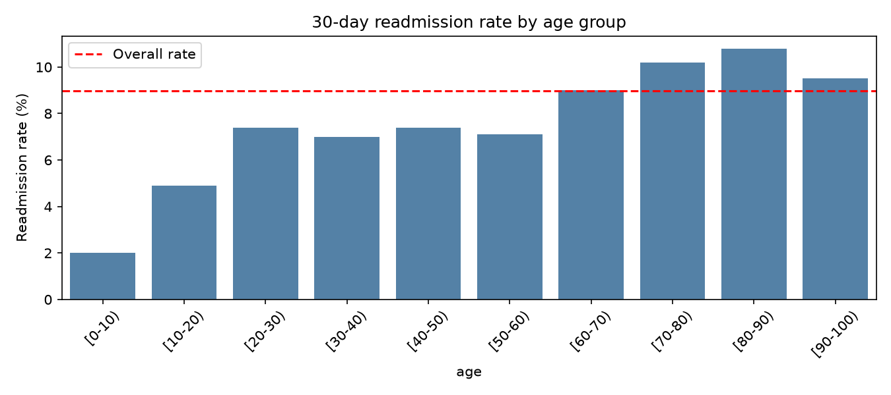
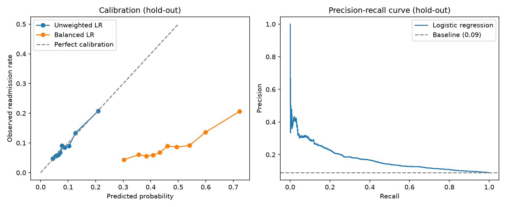
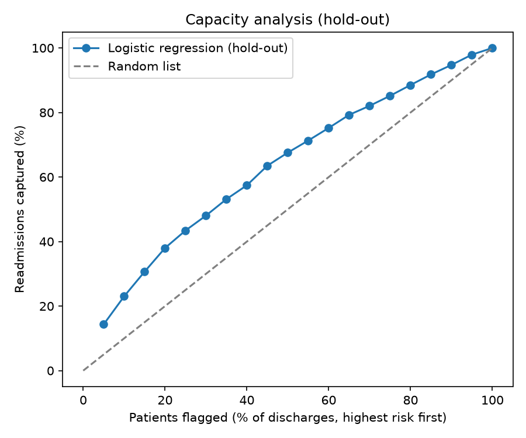

# Hospital Readmission & Medication Analytics

An end-to-end healthcare analytics project: data cleaning and cohort validation, statistical analysis, a 30-day readmission risk model evaluated on a sealed hold-out, and SQL exploration of EHR-structured data (MIMIC-IV demo), with a focus on medication patterns.

**Author:** Ali Aboelsaad | Pharmacist transitioning into healthcare data analytics | [LinkedIn](https://www.linkedin.com/in/ali-aboelsaad-acim)

## Business question
Hospitals cannot follow up with every discharged patient. Which patients are most likely to return within 30 days, and how many readmissions could a limited follow-up team reach by focusing on the highest-risk patients?

## Skills demonstrated
Python (pandas, scikit-learn), SQL (joins, CTEs, window functions), statistical testing, cohort design and leakage prevention, model evaluation on imbalanced data (cross-validation, calibration, precision-recall, capacity analysis), subgroup auditing, and clinical/medication data interpretation.

## Data
| Dataset | Use | Source |
|---|---|---|
| Diabetes 130-US Hospitals (1999-2008), 101,766 encounters, 50 columns | Statistics and machine learning | UCI / Kaggle (Strack et al., 2014) |
| MIMIC-IV Clinical Database Demo v2.2 (100 patients, 275 admissions) | SQL exploration | PhysioNet / Kaggle |

Raw data is **not** included in this repository. Each dataset has its own license and terms; see the source pages.
The diabetes data are historical (1999-2008). The MIMIC demo is a very small sample and is not representative of a hospital population.

## How to read the notebooks
- `notebooks/01_diabetes_eda.ipynb`: Steps 1-6 cover data understanding, cleaning and EDA. Steps 7-9 are early exploratory modeling (compared on a test set while developing, so those numbers are superseded). **Steps 11-13 are the final analysis**: cohort validation, cross-validated model selection, a sealed hold-out evaluated once, calibration, capacity analysis and a subgroup audit. Every number in this README comes from Steps 11-13 or from the EDA steps.
- `notebooks/02_mimic_sql.ipynb`: SQL on the MIMIC-IV demo loaded into a local SQLite database.

## Part 1: Readmission analysis and model

### Cohort definition
| Item | Definition |
|---|---|
| Population | Inpatient encounters of diabetic patients (130 US hospitals, 1999-2008) |
| Unit | One encounter per patient (first encounter) |
| Prediction point | Moment of discharge (only information known at discharge is used) |
| Target | 1 if readmitted within 30 days (`readmitted = "<30"`), otherwise 0 |
| Exclusions | Patients who died or went to hospice (they cannot be readmitted); invalid gender; columns with one value |
| Dropped columns | `weight` (97% missing), `payer_code`, identifiers; `race` is not a model feature (used only for the audit) |
| Final cohort | 69,970 patients (from 101,766 encounters and 71,518 unique patients), 9.0% readmitted within 30 days[cite: 5] |

**Time-order assumption.** The dataset has no dates, so "first encounter" is the lowest `encounter_id`. As a check, prior inpatient visits (`number_inpatient`) increased between consecutive `encounter_id`s of the same patient in 73.7% of 30,248 pairs (equal 16.4%, decreased 9.9%). This supports, but does not prove, that `encounter_id` follows time.

**Sensitivity analysis.** Keeping every eligible encounter (99,340 rows, 69,987 patients, 11.4% readmitted) with a patient-grouped split gave similar results (ROC-AUC 0.653 ± 0.004 vs 0.646 ± 0.008; top 10% captures 22% vs 23%), so the first-encounter design is kept as primary.

### Key findings (associations, not causal effects)
- **Prior inpatient stays** are the strongest signal: readmission rises from 8.1% (none) to 26.5% (3 or more).
- **Discharge destination:** transfers to rehabilitation or other care facilities have 20-26% readmission (e.g. code 22: 26.3%, n=1,409) versus 6.9% for discharge home.
- **Length of stay and age:** about 12% for stays of 8+ days versus 6.5% for 1 day; above 10% for ages 70 and over.
- **Medications:** any dose change 10.1% vs 8.6% without; insulin dose decrease 10.5%, no insulin 8.3%. Drug levels with fewer than 300 patients were excluded from interpretation because their coefficients were unstable. Sicker patients receive more drugs and more changes, so these are not causal effects.
- Statistical tests (chi-square) show age, number of medications, diabetes medication, insulin and medication change are associated with readmission (p < 0.001). With about 70,000 patients, small effects become significant, so effect size is read from the rates.

### Model selection (5-fold cross-validation on the development set, 80%)
| Model | ROC-AUC | PR-AUC |
|---|---|---|
| Dummy reference | 0.500 | 0.090 |
| Logistic regression (balanced) | 0.647 ± 0.006 | 0.164 ± 0.006 |
| Logistic regression (unweighted) | 0.645 ± 0.007 | 0.165 ± 0.007 |
| Random forest | 0.650 ± 0.006 | 0.167 ± 0.008 |
| Gradient boosting | 0.649 ± 0.006 | 0.173 ± 0.007 |

All models perform within noise of each other, so the simplest and most interpretable one, **logistic regression without class weighting**, is the final model. A 20% hold-out set (13,994 patients) was sealed and used only once.

### Final evaluation on the sealed hold-out
| Metric | Value |
|---|---|
| ROC-AUC | 0.640 (95% bootstrap CI 0.626-0.659) |
| PR-AUC | 0.166 (95% CI 0.156-0.190); baseline = prevalence 0.090 |
| Brier score | 0.0793 vs 0.0816 for a constant prediction of the prevalence |

**Calibration.** The unweighted model is well calibrated (mean predicted risk 0.090 = observed 0.090). The class-weighted model ranks patients equally well (ROC-AUC 0.642) but overstates risk (mean 0.47, Brier 0.2297), so it is not used for reporting risk.

**Capacity analysis.** A case-management team that can follow up only a limited share of discharges:

| Flag top | Patients flagged | Readmissions caught | Recall | Precision | Lift |
|---|---|---|---|---|---|
| 5% | 699 | 173 | 13.8% | 24.7% | 2.76x |
| 10% | 1,399 | 278 | 22.2% | 19.9% | 2.22x |
| 20% | 2,798 | 468 | 37.4% | 16.7% | 1.87x |

A threshold of 0.143 chosen on development data (out-of-fold predictions), not on the hold-out, flagged 9.8% of hold-out patients with recall 22.6% and precision 20.7%. About 4 of 5 flagged patients are not readmitted, so any intervention should be low-cost.

### Subgroup audit (race excluded from the model, used only for auditing)
- **Gender:** essentially identical performance (ROC-AUC 0.643 vs 0.639; recall 22.7% vs 22.5%).
- **Age:** alerts concentrate on older patients (80+: 18.5% flagged, recall 32.2%; ages 40-59: 5.0% flagged, recall 15.7%) because age is a strong predictor and the threshold is global.
- **Race:** ROC-AUC and precision are similar for African American (0.649, 20.8%) and Caucasian (0.636, 20.7%) patients, but recall at the fixed threshold is lower for African American patients (17.9% vs 23.5%) because fewer are flagged (7.5% vs 10.5%). With 224 and 964 readmissions the gap is borderline and its cause was not investigated.
- Groups with fewer than 30 readmissions are not interpreted, and many comparisons were made, so isolated differences are hypotheses, not findings. Excluding race from the model does not guarantee equal performance.

## Part 2: MIMIC-IV demo SQL
SQL on the MIMIC-IV demo (loaded into SQLite): joins, CTEs, window functions and validation queries.

- **Validation:** all 31 tables match their source CSV files row for row; integrity checks on 275 admissions found no missing discharge times, negative stays or overlapping next admissions. The database can be rebuilt with a `REBUILD` switch.
- **Diagnoses:** chronic conditions dominate (hypertension in 68 of 275 admissions[cite: 10]). The same disease appears under ICD-9 and ICD-10 codes, so counts are grouped by condition. 112 admissions (41%) carry a diabetes diagnosis[cite: 10].
- **Medications:** IV fluids and flushes were filtered with a name-based heuristic (not a full drug classification). Insulin was ordered in 130 admissions (about 7 orders per admission).
- **Orders are not administrations:** 134 admissions have an insulin order but only 83 have a recorded administration in `emar` (72 have both). `emar` coverage is partial, so the gap does not mean patients were untreated, but it shows that orders overstate exposure.
- **30-day readmission:** 18.8% unplanned (49 of 260 live discharges[cite: 10]; 20.4% for any next admission). This is a tiny sample, so it is illustrative and not comparable with the diabetes dataset (different hospital, case mix, admission types and counting rules).

## Limitations
- The diabetes data are historical (1999-2008), administrative, and lack detailed lab values (only A1C and glucose test categories) and social factors. Performance is modest (ROC-AUC about 0.64), in line with published work on this dataset.
